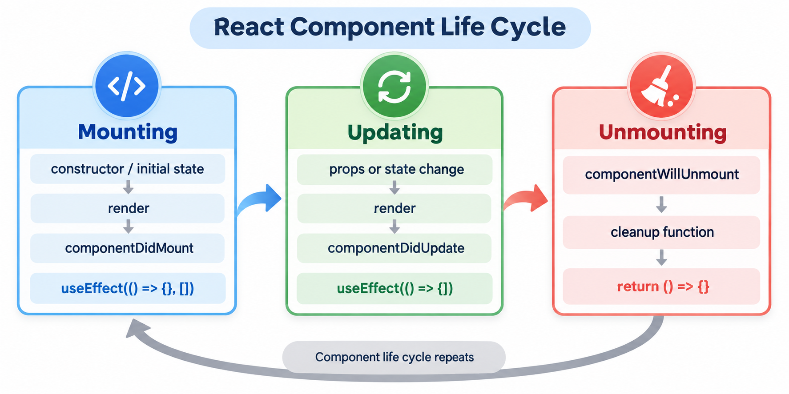

# React Architecture Interview Notes

Purpose: quick interview revision with simple examples, visual mental models, and resume-based talking points.

## Scalable React Application Mental Model

```text
React app
  |
  +-- routes
  +-- features
  +-- shared components
  +-- API layer
  +-- state management
  +-- auth/security
  +-- tests
  +-- build/deployment
```

Interview answer:

A scalable React app should be feature-oriented, typed where possible, tested, secure, and easy for multiple developers to work on.

## Feature-Based Folder Structure

Example:

```text
src/
  features/
    onboarding/
      poi/
      poa/
      liveness/
      shared/
    dashboard/
    auth/
  components/
  services/
  hooks/
  routes/
  utils/
```

Stablehouse example:

```text
features/onboarding/
  poi/
    PoiUpload.jsx
    poiApi.js
  poa/
    PoaUpload.jsx
    poaApi.js
  shared/
    DocumentUpload.jsx
    OnboardingStepLayout.jsx
```

Interview answer:

I prefer feature-based structure for enterprise apps because each business area owns its UI, API calls, tests, and related logic.

## Component Architecture

```text
Page component
  |
  +-- feature component
      |
      +-- shared UI component
```

Example:

```jsx
function OnboardingPage() {
  return (
    <OnboardingStepLayout title="Proof of Identity">
      <DocumentUpload documentType="POI" />
    </OnboardingStepLayout>
  )
}
```

Interview answer:

Pages compose features. Features use shared reusable components. Shared components should be generic and not tightly coupled to one business flow.

## Component Life Cycle



Interview answer:

A React component moves through mounting, updating, and unmounting phases. In class components, lifecycle methods such as `componentDidMount`, `componentDidUpdate`, and `componentWillUnmount` describe those phases. In function components, `useEffect` and its cleanup function cover the same mental model.

## Derived State

Derived state is data that can be calculated from existing props or state. It usually should not be stored as separate state because doing so creates another source of truth that can become out of sync.

```jsx
function Cart({ items }) {
  const total = items.reduce(
    (sum, item) => sum + item.price * item.quantity,
    0
  );

  return <p>Total: ${total}</p>;
}
```

Avoid synchronizing a calculated value with an effect:

```jsx
const [total, setTotal] = useState(0);

useEffect(() => {
  setTotal(calculateTotal(items));
}, [items]);
```

Common examples include filtered or sorted lists, cart totals, full names, completed-item counts, and whether a control should be disabled. Calculate inexpensive values during rendering. Use `useMemo` only when the calculation is genuinely expensive:

```jsx
const visibleItems = useMemo(
  () => items.filter((item) => item.name.includes(searchTerm)),
  [items, searchTerm]
);
```

Interview answer:

If a value can be calculated from current props or state, derive it during rendering instead of storing it in state. Store only information that changes independently.

## API Layer Organization

Avoid calling raw `fetch` or Axios directly in every component.

```text
Component
  |
  v
custom hook / service function
  |
  v
API client
  |
  v
Backend
```

Example:

```jsx
async function uploadDocument({ documentType, file }) {
  const formData = new FormData()
  formData.append("documentType", documentType)
  formData.append("document", file)

  const response = await fetch("/api/documents/upload", {
    method: "POST",
    body: formData,
  })

  if (!response.ok) {
    throw new Error("Upload failed")
  }

  return response.json()
}
```

Usage:

```jsx
function PoiUpload() {
  async function handleUpload(file) {
    await uploadDocument({ documentType: "POI", file })
  }

  return <DocumentUpload onUpload={handleUpload} />
}
```

Interview answer:

I keep API logic behind service functions or custom hooks so components stay focused on UI.

## State Boundaries

```text
Local UI state -> useState/useReducer
Shared client state -> Context/Redux
Server data -> TanStack Query/RTK Query/Apollo/SWR
URL state -> search params
```

Interview answer:

I do not put all state in Redux or Context. I choose state location based on ownership and scope.

## Reusable Component Design

Good reusable components:

- clear props
- predictable behavior
- accessible by default
- support loading/error states
- do not know too much business logic

Example:

```jsx
function Button({ variant = "primary", disabled, children, onClick }) {
  return (
    <button className={`button ${variant}`} disabled={disabled} onClick={onClick}>
      {children}
    </button>
  )
}
```

Interview answer:

Reusable components should be flexible but not overly generic. I design them around real use cases.

## Compound Components

Compound components allow related components to work together.

```jsx
function Tabs({ children }) {
  return <div>{children}</div>
}

Tabs.List = function TabsList({ children }) {
  return <div role="tablist">{children}</div>
}

Tabs.Panel = function TabsPanel({ children }) {
  return <div>{children}</div>
}
```

Interview answer:

Compound components are useful when building flexible UI APIs like tabs, accordions, menus, and modals.

## Render Props

Render props means passing a function as a prop so the component can decide what to render.

```jsx
function MouseTracker({ render }) {
  const [position, setPosition] = useState({ x: 0, y: 0 })

  return (
    <div
      onMouseMove={(event) => {
        setPosition({ x: event.clientX, y: event.clientY })
      }}
    >
      {render(position)}
    </div>
  )
}

function App() {
  return (
    <MouseTracker
      render={(position) => (
        <p>
          X: {position.x}, Y: {position.y}
        </p>
      )}
    />
  )
}
```

Interview answer:

Render props are useful when a component owns reusable logic but lets the consumer decide the UI. Today, many render-prop use cases are handled by custom hooks.

## Higher-Order Components

A higher-order component is a function that takes a component and returns an enhanced component.

```jsx
function withAuth(Component) {
  return function ProtectedComponent(props) {
    const isLoggedIn = Boolean(localStorage.getItem("token"))

    if (!isLoggedIn) {
      return <p>Please login</p>
    }

    return <Component {...props} />
  }
}
```

Interview answer:

HOCs are used for cross-cutting behavior like auth, logging, feature flags, or permissions. In modern React, custom hooks and wrapper components are often preferred because they are simpler to compose.

## Error Boundaries In Architecture

```text
App
  |
  +-- Route ErrorBoundary
      |
      +-- Dashboard ErrorBoundary
      +-- Upload Widget ErrorBoundary
```

Interview answer:

I place Error Boundaries around routes or high-risk modules so one widget failure does not crash the whole app.

## Feature Flags

Feature flags let teams deploy code but control release separately.

```jsx
function FeatureGate({ enabled, children }) {
  if (!enabled) return null
  return children
}
```

Usage:

```jsx
<FeatureGate enabled={flags.newLivenessFlow}>
  <LivenessVerification />
</FeatureGate>
```

Interview answer:

Feature flags help release gradually, test with selected users, and quickly disable risky features.

## Enterprise App Architecture

Enterprise React apps need:

- feature modules
- shared component library
- API client layer
- authentication
- authorization
- error handling
- logging/monitoring
- test strategy
- CI/CD
- code quality gates

Interview answer:

For an enterprise app, I focus on maintainability, consistency, security, performance, and team scalability.

## Stablehouse Resume Example

```text
Stablehouse onboarding
  |
  +-- POI module
  +-- POA module
  +-- Investor Type module
  +-- Account Type module
  +-- Liveness module
  +-- Shared document upload
  +-- GraphQL/API layer
  +-- Auth0/auth layer
```

Interview answer:

In Stablehouse, onboarding modules like POI, POA, account type, and liveness can be organized as separate features while sharing upload, layout, validation, and API patterns.

## HNB Digital Lobby Resume Example

```text
HNB Digital Lobby
  |
  +-- migrated Angular to React
  +-- reusable components
  +-- REST API integration
  +-- Context/Redux state
  +-- lazy loading
  +-- Jenkins CI/CD
```

Interview answer:

In HNB Digital Lobby, a feature-based React architecture helped improve maintainability and performance during Angular-to-React migration.

## Quick Interview Summary

- Prefer feature-based architecture for large apps.
- Keep shared components generic and accessible.
- Keep API logic outside UI components.
- Separate local, global, server, and URL state.
- Use Error Boundaries for risky sections.
- Use feature flags for safe releases.
- Add testing, CI/CD, and code quality gates.
