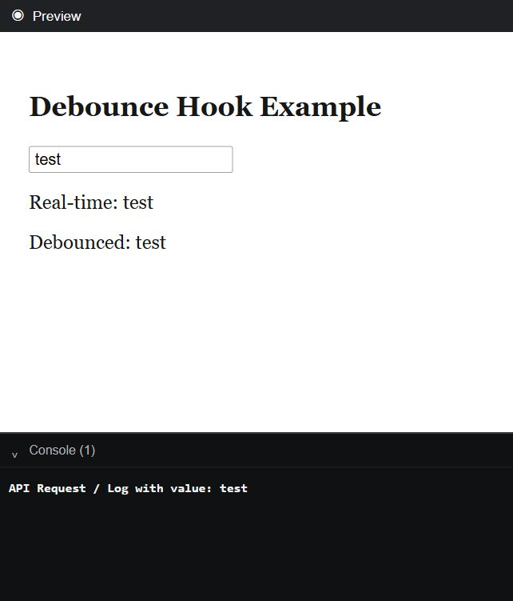

# React Optimization Interview Notes

Purpose: quick interview revision with simple JavaScript examples.

## How To Optimize A React App

Start by measuring, not guessing.

Tools:

- React DevTools Profiler
- browser Performance tab
- Lighthouse
- Web Vitals
- bundle analyzer
- network tab

Common optimization areas:

- unnecessary re-renders
- expensive calculations
- large lists
- large bundles
- repeated API calls
- large images
- slow forms
- heavy third-party libraries

Interview answer:

I first identify the bottleneck. Then I choose the right technique: memoization for expensive renders, virtualization for large lists, lazy loading for bundle size, and server-state caching for repeated API calls.

## Optimization Step-By-Step Workflow

Use this flow when the interviewer asks, "How do you optimize a React app?"

```text
1. Measure the problem
   |
   v
2. Identify the bottleneck
   |
   v
3. Choose the right optimization
   |
   v
4. Verify improvement
   |
   v
5. Keep the code maintainable
```

Common mapping:

```text
Unnecessary child re-renders -> React.memo / useCallback
Expensive calculations       -> useMemo
Large lists                  -> virtualization
Large bundle                 -> lazy loading / code splitting
Repeated API calls           -> TanStack Query / RTK Query /  SWR / Apollo
Large images                 -> compression / responsive images / lazy loading
Slow typing UI               -> debounce / useDeferredValue / useTransition
```

Example interview answer:

If a dashboard feels slow, I would first profile it using React DevTools and the browser Performance tab. If the problem is too many renders, I optimize component boundaries. If the problem is a large table, I use pagination or virtualization. If the problem is repeated API calls, I use a server-state cache such as TanStack Query or RTK Query.

## Debounce Vs Throttle

Both debounce and throttle are performance techniques used to control how often a function runs.

Common use cases:

- search input
- autocomplete
- scroll events
- resize events
- API calls

### Debounce

Debounce waits until the user stops triggering the event for a specific time.

Example scenario:

```text
User types: k
User types: ka
User types: kar
User stops typing
Wait 500ms
Call API once for "kar"
```

Debounce is best for search boxes and autocomplete.

```jsx
import { useEffect, useState } from "react";

function SearchBox() {
  const [query, setQuery] = useState("");
  const [debouncedQuery, setDebouncedQuery] = useState("");

  useEffect(() => {
    const timerId = setTimeout(() => {
      setDebouncedQuery(query);
    }, 500);

    return () => {
      clearTimeout(timerId);
    };
  }, [query]);

  useEffect(() => {
    if (!debouncedQuery) return;

    console.log("API call for:", debouncedQuery);
  }, [debouncedQuery]);

  return (
    <input
      value={query}
      onChange={(event) => setQuery(event.target.value)}
      placeholder="Search user"
    />
  );
}
```

#### Reusable `useDebounce` Hook

In a real project, debounce logic is usually extracted into a custom hook so it can be reused by search boxes, filters, validation, autosave, and other features.

**`useDebounce.js`**

```jsx
import { useEffect, useState } from "react";

export function useDebounce(value, delay = 500) {
  const [debouncedValue, setDebouncedValue] = useState(value);

  useEffect(() => {
    const handler = setTimeout(() => {
      setDebouncedValue(value);
    }, delay);

    return () => clearTimeout(handler);
  }, [value, delay]);

  return debouncedValue;
}
```

**`App.jsx`**

```jsx
import { useEffect, useState } from "react";
import { useDebounce } from "./useDebounce";

function App() {
  const [search, setSearch] = useState("");
  const debouncedSearch = useDebounce(search, 500);

  useEffect(() => {
    if (debouncedSearch) {
      console.log("API Request / Log with value:", debouncedSearch);
    }
  }, [debouncedSearch]);

  return (
    <div style={{ padding: "20px" }}>
      <h2>Debounce Hook Example</h2>
      <input
        type="text"
        value={search}
        onChange={(event) => setSearch(event.target.value)}
        placeholder="Type here..."
      />
      <p>Real-time: {search}</p>
      <p>Debounced: {debouncedSearch}</p>
    </div>
  );
}

export default App;
```

#### Output



- `search` changes immediately on every keystroke, so **Real-time** displays the current input.
- Each change cancels the previous timer through the effect cleanup function.
- After the user stops typing for 500 ms, `debouncedSearch` becomes `"test"` and the effect logs the API request.
- In a production application, replace `console.log` with the API call or query trigger.

Flow:

```text
User types "k"
   |
   v
Start 500ms timer

User types "ka" before 500ms
   |
   v
Clear old timer
Start new 500ms timer

User types "kar" before 500ms
   |
   v
Clear old timer
Start new 500ms timer

User stops typing
   |
   v
Timer completes
   |
   v
API call happens once
```

Interview answer:

> Debounce delays function execution until the user stops triggering the event for a given time. I use debounce for search inputs because we do not want to call the API on every keystroke.

### Throttle

Throttle runs a function at most once in a fixed time interval.

Example scenario:

```text
User scrolls continuously
Function runs once every 500ms
```

Throttle is best for scroll, resize, and mouse move events.

```jsx
import React, { useState, useEffect, useRef } from 'react';

function App() {
  const [scrollY, setScrollY] = useState(0);

  // Use useRef to persist the flag across re-renders without causing new re-renders
  const canRunRef = useRef(true);

  useEffect(() => {
    function handleScroll() {
      // If lock is active, ignore the scroll event
      if (!canRunRef.current) return;

      // Lock execution
      canRunRef.current = false;
      setScrollY(window.scrollY);

      // Release lock after 500ms delay
      setTimeout(() => {
        canRunRef.current = true;
      }, 500);
    }

    window.addEventListener("scroll", handleScroll);

    return () => {
      window.removeEventListener("scroll", handleScroll);
    };
  }, []);

  return (
    <div style={{ height: '200vh', padding: '20px' }}>
      <h2>Scroll position: {scrollY}</h2>
      <p>Scroll down the page—the state updates at most once every 500ms.</p>
    </div>
  );
}

export default App;

Best Practice Alternative: Reusable Custom Hook (useThrottle)

import React, { useState, useEffect, useRef } from 'react';

// Custom Hook for throttled values
function useThrottledValue(value, limit = 500) {
  const [throttledValue, setThrottledValue] = useState(value);
  const lastRan = useRef(Date.now());

  useEffect(() => {
    const handler = setTimeout(() => {
      if (Date.now() - lastRan.current >= limit) {
        setThrottledValue(value);
        lastRan.current = Date.now();
      }
    }, limit - (Date.now() - lastRan.current));

    return () => clearTimeout(handler);
  }, [value, limit]);
  
  return throttledValue;
}
```

Flow:

```text
User scrolls
   |
   v
Function runs immediately
   |
   v
For next 500ms, ignore scroll events
   |
   v
After 500ms, allow next function call
```

Interview answer:

> Throttle ensures a function runs at most once within a fixed interval. I use throttle for scroll, resize, and mouse move events where events fire continuously.

### Main Difference

```text
Debounce:
Wait until events stop, then run once.

Throttle:
Run at regular intervals while events continue.
```

| Feature   | Debounce                         | Throttle                 |
| --------- | -------------------------------- | ------------------------ |
| Runs when | After user stops                 | At fixed intervals       |
| Best for  | Search input                     | Scroll/resize            |
| API calls | Reduces calls until typing stops | Limits calls over time   |
| Example   | Search after 500ms pause         | Track scroll every 500ms |

Best interview answer:

> Debounce delays execution until the event stops firing for a specified delay. Throttle limits execution to once per interval while the event continues firing. I use debounce for search/autocomplete API calls and throttle for scroll or resize listeners.

## React.memo

`React.memo` memoizes a component and skips re-rendering if props are shallowly equal.

```jsx
import React, { useState } from "react";

const Child = React.memo(function Child({ name }) {
  console.log("Child rendered");
  return <h2>Hello, {name}</h2>;
});

function Parent() {
  const [count, setCount] = useState(0);
  const [name, setName] = useState("Karteek");

  return (
    <div>
      <button onClick={() => setCount(count + 1)}>Count: {count}</button>
      <button onClick={() => setName("React")}>Change Name</button>
      <Child name={name} />
    </div>
  );
}
```

What happens:

```text
Click Count
  |
  v
Parent re-renders
  |
  v
Child does not re-render because name did not change
```

Interview answer:

Use `React.memo` for expensive child components with stable props. Do not use it everywhere because memoization also has a cost.

## useMemo

`useMemo` memoizes an expensive calculated value.

```jsx
import { useMemo, useState } from "react";

function ProductList({ products }) {
  const [search, setSearch] = useState("");

  const filteredProducts = useMemo(() => {
    return products.filter((product) =>
      product.name.toLowerCase().includes(search.toLowerCase()),
    );
  }, [products, search]);

  return (
    <div>
      <input
        value={search}
        onChange={(event) => setSearch(event.target.value)}
      />
      {filteredProducts.map((product) => (
        <p key={product.id}>{product.name}</p>
      ))}
    </div>
  );
}
```

Interview answer:

Use `useMemo` when recalculating a derived value is expensive. Avoid it for cheap calculations.

## useCallback

`useCallback` memoizes a function reference.

```jsx
import React, { useCallback, useState } from "react";

const SaveButton = React.memo(function SaveButton({ onSave }) {
  console.log("SaveButton rendered");
  return <button onClick={onSave}>Save</button>;
});

function Parent() {
  const [text, setText] = useState("");

  const handleSave = useCallback(() => {
    console.log("Saved:", text);
  }, [text]);

  return (
    <div>
      <input value={text} onChange={(event) => setText(event.target.value)} />
      <SaveButton onSave={handleSave} />
    </div>
  );
}
```

Interview answer:

Use `useCallback` when stable function identity matters, especially with memoized child components or custom hooks.

### useMemo Vs useCallback: What Is The Actual Difference?

Both hooks cache something until their dependencies change. The difference is what they return:

```jsx
const value = useMemo(() => calculateValue(a, b), [a, b])
const callback = useCallback(() => doSomething(a, b), [a, b])
```

```text
useMemo     -> calls the factory and caches its returned value
useCallback -> caches the function itself
```

Conceptually, these are equivalent:

```jsx
useCallback(fn, dependencies)
useMemo(() => fn, dependencies)
```

`useMemo` genuinely helps when a calculation is measurably expensive and its dependencies usually remain stable:

```jsx
const visibleTransactions = useMemo(
  () => sortAndFilterTransactions(transactions, filters),
  [transactions, filters]
)
```

`useCallback` genuinely helps when function identity matters, commonly when passing a callback to a memoized child:

```jsx
const ExportButton = React.memo(function ExportButton({ onExport }) {
  return <button onClick={onExport}>Export</button>
})

function Report({ reportId }) {
  const [theme, setTheme] = useState("light")

  const handleExport = useCallback(() => {
    exportReport(reportId)
  }, [reportId])

  return <ExportButton onExport={handleExport} />
}
```

Without `React.memo` or another identity-sensitive consumer, stabilizing `handleExport` usually does not prevent any render.

Both are premature when the work is cheap, dependencies change every render, or no consumer benefits from stable identity:

```jsx
// Simpler than memoizing a cheap expression.
const fullName = `${firstName} ${lastName}`

// Usually unnecessary for a normal DOM button.
const handleClick = () => setOpen(true)
```

Memoization adds dependency comparisons, retained values, and cognitive overhead. It is a performance optimization, not a semantic guarantee; code should remain correct if React recalculates a memoized value.

Interview answer:

`useMemo` caches a calculated value, while `useCallback` caches a function reference. I use them when profiling shows expensive repeated work or when stable identity allows a memoized child or hook dependency to avoid work. I avoid them for cheap calculations and ordinary callbacks because memoization also has a cost.

## React.memo Vs useMemo

```text
React.memo
  |
  +-- memoizes component render

useMemo
  |
  +-- memoizes calculated value
```

Interview answer:

Use `React.memo` to avoid re-rendering a child component when props do not change. Use `useMemo` to avoid recalculating an expensive value.

## Lazy Loading And Code Splitting

Lazy loading loads code only when needed.

```jsx
import { lazy, Suspense } from "react";

const ReportsPage = lazy(() => import("./ReportsPage"));

function App() {
  return (
    <Suspense fallback={<p>Loading reports...</p>}>
      <ReportsPage />
    </Suspense>
  );
}
```

Interview answer:

Lazy loading reduces initial bundle size by splitting large routes or components into separate chunks.

## Suspense

`Suspense` shows fallback UI while lazy-loaded code is loading.

```jsx
<Suspense fallback={<p>Loading...</p>}>
  <LazyComponent />
</Suspense>
```

Interview answer:

Suspense is commonly used with `React.lazy` for code loading. In framework-supported setups, it can also coordinate async rendering.

## Virtualized Lists

Virtualization renders only visible rows from a large list.

Manual concept:

```jsx
import { useState } from "react";

const items = Array.from({ length: 10000 }, (_, index) => `Row ${index + 1}`);
const rowHeight = 40;
const visibleCount = 10;

function VirtualizedListExample() {
  const [scrollTop, setScrollTop] = useState(0);
  const startIndex = Math.floor(scrollTop / rowHeight);
  const visibleItems = items.slice(startIndex, startIndex + visibleCount);

  return (
    <div
      style={{ height: 400, overflow: "auto" }}
      onScroll={(event) => setScrollTop(event.currentTarget.scrollTop)}
    >
      <div style={{ height: items.length * rowHeight, position: "relative" }}>
        {visibleItems.map((item, index) => {
          const actualIndex = startIndex + index;

          return (
            <div
              key={item}
              style={{
                position: "absolute",
                top: actualIndex * rowHeight,
                height: rowHeight,
              }}
            >
              {item}
            </div>
          );
        })}
      </div>
    </div>
  );
}
```

Interview answer:

Virtualized lists improve performance by rendering only visible items instead of thousands of DOM nodes.

## React Virtuoso

React Virtuoso is a virtualization library.

```bash
npm install react-virtuoso
```

```jsx
import { Virtuoso } from "react-virtuoso";

const users = Array.from({ length: 10000 }, (_, index) => ({
  id: index + 1,
  name: `User ${index + 1}`,
  email: `user${index + 1}@example.com`,
}));

function UsersVirtualList() {
  return (
    <Virtuoso
      style={{ height: 400 }}
      data={users}
      itemContent={(index, user) => (
        <div style={{ padding: 12, borderBottom: "1px solid #ddd" }}>
          <strong>{user.name}</strong>
          <p>{user.email}</p>
        </div>
      )}
    />
  );
}
```

Interview answer:

For large datasets like transactions, audit logs, or onboarding records, I would use a virtualization library such as React Virtuoso to keep scrolling smooth.

## Pagination

Pagination loads data page by page.

```jsx
import { useEffect, useState } from "react";

function ProductsPage() {
  const [page, setPage] = useState(1);
  const [products, setProducts] = useState([]);

  useEffect(() => {
    fetch(`/api/products?page=${page}`)
      .then((res) => res.json())
      .then(setProducts);
  }, [page]);

  return (
    <div>
      {products.map((product) => (
        <p key={product.id}>{product.name}</p>
      ))}

      <button disabled={page === 1} onClick={() => setPage(page - 1)}>
        Previous
      </button>

      <button onClick={() => setPage(page + 1)}>Next</button>
    </div>
  );
}
```

Interview answer:

Use server-side pagination for large datasets so the frontend does not download everything at once.

## Infinite Scroll

Infinite scroll loads more items as the user scrolls.

```jsx
import { useEffect, useRef, useState } from "react";

function InfiniteProducts() {
  const [page, setPage] = useState(1);
  const [products, setProducts] = useState([]);
  const loaderRef = useRef(null);

  useEffect(() => {
    fetch(`/api/products?page=${page}`)
      .then((res) => res.json())
      .then((newProducts) => {
        setProducts((current) => [...current, ...newProducts]);
      });
  }, [page]);

  useEffect(() => {
    const observer = new IntersectionObserver((entries) => {
      if (entries[0].isIntersecting) {
        setPage((currentPage) => currentPage + 1);
      }
    });

    if (loaderRef.current) {
      observer.observe(loaderRef.current);
    }

    return () => observer.disconnect();
  }, []);

  return (
    <div>
      {products.map((product) => (
        <p key={product.id}>{product.name}</p>
      ))}

      <div ref={loaderRef}>Loading more...</div>
    </div>
  );
}
```

Interview answer:

Infinite scroll is useful for feeds and search results, but pagination is often better for transactional data where users need exact navigation.

## Image Optimization

Techniques:

- use correct image dimensions
- compress images
- use modern formats like WebP/AVIF
- lazy load below-the-fold images
- use responsive `srcset`
- avoid layout shift with width/height

Example:

```jsx

```

Interview answer:

Image optimization improves loading performance and Core Web Vitals.

## Bundle Optimization

Techniques:

- route-level code splitting
- remove unused dependencies
- tree shaking
- dynamic imports
- analyze bundle size
- avoid large libraries for small tasks

Example:

```jsx
const ChartPage = lazy(() => import("./ChartPage"));
```

Interview answer:

For a dashboard with many modules, I would lazy load routes and heavy modules so users do not download all code upfront.

## Reducing Unnecessary Re-Renders

Techniques:

- keep state close to where it is used
- avoid unnecessary context updates
- use `React.memo` for expensive children
- use stable props
- use `useMemo` and `useCallback` only when needed

Bad:

```jsx
<UserCard config={{ showRole: true }} />
```

This creates a new object every render.

Better:

```jsx
const config = useMemo(() => ({ showRole: true }), [])

<UserCard config={config} />
```

Interview answer:

I reduce re-renders by colocating state, stabilizing expensive props, and using memoization only after identifying a real performance issue.

### Deeply Nested Tree Without A State Library

Depth is not automatically the problem. The first question is which state update causes expensive components to render and whether those components actually depend on that state.

A practical workflow:

1. Measure with the React DevTools Profiler.
2. Colocate state near the smallest subtree that uses it.
3. Use component composition so changing wrapper state does not recreate unrelated children.
4. Split broad context by responsibility and update frequency.
5. Add `React.memo` around genuinely expensive children with stable props.
6. Stabilize only the object and callback props that cross those memo boundaries.

State colocation prevents a page-level update for local UI:

```jsx
function FilterPanel() {
  const [isAdvancedOpen, setIsAdvancedOpen] = useState(false)
  // Only this subtree needs to render when the panel toggles.
}
```

Composition can isolate stateful wrappers:

```jsx
function ModalState({ children }) {
  const [isOpen, setIsOpen] = useState(false)

  return (
    <>
      <button onClick={() => setIsOpen(true)}>Open</button>
      {isOpen && <Modal>{children}</Modal>}
    </>
  )
}
```

Because `children` was created by the parent, updating `ModalState` does not itself recreate that element.

Avoid one provider containing unrelated frequently changing values:

```jsx
// Broad updates can notify every consumer.
<AppContext.Provider value={{ user, theme, livePrices }}>
```

Prefer focused providers such as `UserContext`, `ThemeContext`, and `LivePricesContext`. Memoize a provider value when necessary, but remember that all consumers of a context are notified when that context value changes.

Real-time scenario: in a trading dashboard, a live price update should not force the navigation, profile menu, and settings form through the same context update. Keep fast-changing price data in a focused subtree/context and keep local panel state inside each panel.

Interview answer:

I start by profiling, then colocate state, use composition, and split contexts by concern and update frequency. I add memo boundaries only around expensive subtrees and keep props stable where those boundaries need it. A deeply nested tree alone is not a reason to add Redux.

## React Profiler

React DevTools Profiler helps identify:

- which components rendered
- why they rendered
- how long rendering took
- expensive components

Interview answer:

I use React Profiler before optimizing so I can fix measured bottlenecks instead of guessing.

## Web Vitals

Important metrics:

- LCP: loading performance
- INP: responsiveness
- CLS: layout stability

Interview answer:

Web Vitals help measure real user experience. I optimize images, bundles, rendering, and layout stability based on these metrics.

## Resume-Based Examples

HNB Digital Lobby:

- React Profiler helped identify expensive rendering.
- Lazy loading reduced initial page load.
- Reusable components improved maintainability.

Stablehouse:

- POI/POA upload screens should avoid unnecessary re-renders.
- Onboarding status should be cached as server state.
- Large audit logs or review queues can use virtualization.

## Quick Interview Summary

- Measure before optimizing.
- Use `React.memo` for expensive children.
- Use `useMemo` for expensive values.
- Use `useCallback` for stable callbacks.
- Use lazy loading for bundle size.
- Use virtualization for large lists.
- Use server-side pagination for large datasets.
- Use query caching for repeated API data.
- Optimize images and bundles for Web Vitals.
